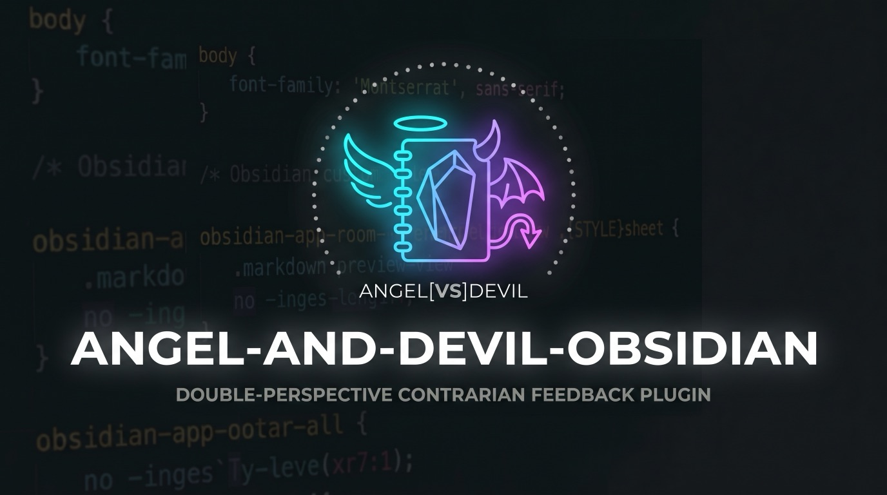

# Angel & Devil (Obsidian plugin)

**English** | [日本語 (README_ja.md)](README_ja.md)

An angel 😇 and a devil 😈 read your note and banter about it. The angel finds concrete things to praise; the devil teases your slips and smuggles in one real, sharp point per turn.

https://github.com/user-attachments/assets/c8639819-61c3-4158-adbb-76ce91a943aa

Status: **Phase 2 in progress** — text banter, animated modal, save to note, and read aloud with Gemini TTS (two voices, pitch-preserving speed, characters react to the voice).

## Installation

### Option 1: Install script (from GitHub Releases)

Download the latest release directly into your Obsidian vault (`data.json` settings are preserved on updates):

```sh
curl -fsSL https://raw.githubusercontent.com/koooyooo/angel-and-devil-obsidian/main/install.sh | sh -s -- /path/to/your/vault
```

To install a specific version, pass it as the second argument:

```sh
curl -fsSL https://raw.githubusercontent.com/koooyooo/angel-and-devil-obsidian/main/install.sh | sh -s -- /path/to/your/vault 0.1.0
```

Then in Obsidian: **Settings → Community plugins** → turn off **Restricted mode** if needed, and enable **Angel & Devil** (if updating, turn the plugin off and on again or reload Obsidian).

### Option 2: BRAT (auto-updates)

1. Install the [BRAT](https://github.com/TfTHacker/obsidian42-brat) community plugin in Obsidian.
2. Open **Settings → BRAT → Add Beta plugin** and enter `koooyooo/angel-and-devil-obsidian`.
3. Enable **Angel & Devil** under **Settings → Community plugins**.

### Option 3: Manual download

1. Download `angel-and-devil.zip` (or `main.js`, `manifest.json`, and `styles.css`) from the [latest GitHub Release](https://github.com/koooyooo/angel-and-devil-obsidian/releases/latest).
2. Extract `main.js`, `manifest.json`, and `styles.css` into `<vault>/.obsidian/plugins/angel-and-devil/`.
3. Enable **Angel & Devil** under **Settings → Community plugins**.

## Usage

1. Get a Gemini API key from [Google AI Studio](https://aistudio.google.com/apikey) and enter it in **Settings → Angel & Devil**. Use **Check key** to confirm it works.
2. Open a note and press the 😇😈 button in the note header (or the ribbon icon, or the command **Angel & Devil: Start banter**). Select text first to banter about just that part.
3. Click / tap or press Space to advance, **Skip** to show everything, **Again** to regenerate, **Save to end of note** to append the banter as a quote block.
4. Optional: turn on **Read aloud** in the settings to get a 🔊 button. You are asked before every Gemini TTS call (can be turned off); replaying the same banter uses a local cache and makes no request.
5. Optional: turn on **Remember banters** in the settings. After every banter (saving is not needed), both characters leave a short memo, and later banters can refer back to them. Another banter on the same note on the same day (for example **Again**) replaces that day's record. Everything is kept as ordinary notes in a vault folder (default `_angel_and_devil/`, configurable):
   - `history.md`: one line per note and day, with a link to the note.
   - `angel_memo.md` / `devil_memo.md`: each character's memos; only the latest 10 are kept. Edit or delete them freely.

## Network use and privacy

- When you start a banter, the note text (or your selection) is sent to the **Google Gemini API** (`generativelanguage.googleapis.com`) using **your own API key**. Nothing is sent at any other time.
- Frontmatter and previously saved banter blocks are removed before sending.
- There is no server of our own and no telemetry.
- The API key is stored in **SecretStorage**, Obsidian's standard place for plugin secrets (Obsidian 1.11.4+; older versions use this plugin's `data.json` in plain text). Other installed plugins can still read it. Details: [docs/api-key.md](docs/api-key.md).
- Memory (off by default) also sends each character's latest memos (up to 10 each) with the note. `history.md` is never sent. Memos are written only when you save a banter.
- Read aloud (off by default) sends the generated banter text to Gemini TTS. Audio is kept in memory only.
- Gemini API usage — especially TTS — may be billed to your Google account.
- Use a **dedicated** API key with a **spend cap** — see [Recommended key hygiene](docs/api-key.md#recommended-key-hygiene).

## Disclaimer

This plugin is provided **as is, without warranty of any kind**, as far as the law allows. The author is not liable for any damages arising from its use (see "No Liability" in [LICENSE](LICENSE)). In particular:

- **API costs are yours.** Requests are made with your own Gemini API key, and any charges from Google — especially for read aloud (TTS) — are billed to your Google account. Check [Google's pricing](https://aistudio.google.com/docs/pricing) and set a spend cap and budget alert (see [Recommended key hygiene](docs/api-key.md#recommended-key-hygiene)).
- **Keeping your API key safe is your responsibility.** The author is not liable for any damages or charges caused by a leaked or misused key. See [docs/api-key.md](docs/api-key.md).
- **Your notes are sent to Google.** When you start a banter, the note text (or your selection) is sent to the Gemini API and handled under Google's terms and privacy policy. Do not use the plugin on notes you must not share with a third party.
- **AI output can be wrong or uncomfortable.** The banter is generated by AI. It may be inaccurate, misread your note, or feel harsh — the Devil teases on purpose. It is entertainment, not professional advice (medical, mental-health, legal, financial, or otherwise).
- **Your notes are only changed when you ask.** The plugin writes to a note only when you press "Save to end of note". Keep backups of your vault as usual.
- **Third-party services may change.** Gemini models, voices, pricing, and APIs can change or stop without notice, which may break features.

## Development

```sh
npm install
npm run dev     # watch build -> main.js
npm run build   # type-check + production build
npm test        # unit tests (Vitest)
```

Copy or symlink `main.js`, `manifest.json`, `styles.css` into `<vault>/.obsidian/plugins/angel-and-devil/`, turn off restricted mode, and enable the plugin. Sample notes for manual testing are in `test/fixtures/notes/`.

The persona prompts in `src/prompts/angel.md` and `devil.md` come from the CLI / Agent Skill version, [dot-agent-angel-and-devil](https://github.com/koooyooo/dot-agent-angel-and-devil) (`skills/angel-and-devil-note/references/`).

## License

[PolyForm Shield 1.0.0](LICENSE) — Copyright 2026 koooyooo.

You may use, change, and share this plugin for **any purpose, including at work and in companies**. What you may not do is provide a product that **competes** with this plugin, or with a product the author provides using it (for example, selling a copy of it or hosting it as a paid service). See [LICENSE](LICENSE) for the exact terms.

The persona prompts in `src/prompts/` are by the same author and are covered by this license in this repository.
