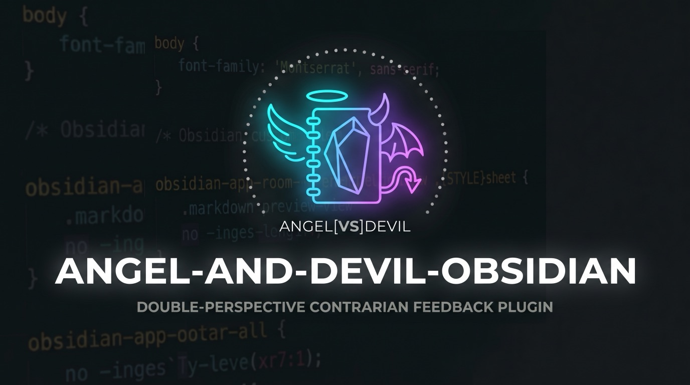

# Angel & Devil (Obsidian プラグイン)

[English (README.md)](README.md) | **日本語**

天使 😇 と悪魔 😈 があなたのノートを読んで掛け合いをする Obsidian プラグインです。天使はノートの中から具体的に褒められる点を見つけ、悪魔はちょっとした隙をからかいながら毎ターン鋭い指摘をひとつ混ぜ込みます。

https://github.com/user-attachments/assets/c8639819-61c3-4158-adbb-76ce91a943aa

ステータス: **Phase 2 進行中** — テキスト掛け合い、アニメーション付きモーダル、ノート末尾への保存、Gemini TTS による音声読み上げ（2話者・ピッチ維持の速度調整・声に合わせたキャラクターのリアクション）に対応しています。

## インストール方法

### 方法 1: インストールスクリプトを使う（GitHub Releases から直接導入）

最新の Release からビルド済みファイル（`main.js`, `manifest.json`, `styles.css`）を Obsidian の Vault（保管庫）へ直接ダウンロードして配置します（更新時も既存の設定 `data.json` はそのまま保持されます）。

```sh
curl -fsSL https://raw.githubusercontent.com/koooyooo/angel-and-devil-obsidian/main/install.sh | sh -s -- /path/to/your/vault
```

特定のバージョンを指定してインストールする場合は、第2引数にバージョンを渡します:

```sh
curl -fsSL https://raw.githubusercontent.com/koooyooo/angel-and-devil-obsidian/main/install.sh | sh -s -- /path/to/your/vault 0.1.0
```

実行後、Obsidian の **設定 → コミュニティプラグイン** を開き、必要に応じて **制限モード** をオフにした上で **Angel & Devil** を有効化してください（アップデート時は一度オフ→オンにするか、Obsidian をリロードしてください）。

### 方法 2: BRAT を使う（自動アップデート対応）

1. Obsidian のコミュニティプラグインから [BRAT](https://github.com/TfTHacker/obsidian42-brat) をインストールします。
2. **設定 → BRAT → Add Beta plugin** を開き、`koooyooo/angel-and-devil-obsidian` を入力して追加します。
3. **設定 → コミュニティプラグイン** で **Angel & Devil** を有効化します。

### 方法 3: 手動ダウンロード

1. [最新の GitHub Release](https://github.com/koooyooo/angel-and-devil-obsidian/releases/latest) から `angel-and-devil.zip`（または `main.js`, `manifest.json`, `styles.css` の3ファイル）をダウンロードします。
2. `<vault>/.obsidian/plugins/angel-and-devil/` フォルダを作成し、その中に `main.js`, `manifest.json`, `styles.css` を配置します。
3. **設定 → コミュニティプラグイン** で **Angel & Devil** を有効化します。

## 使い方

1. [Google AI Studio](https://aistudio.google.com/apikey) で Gemini API キーを取得し、Obsidian の **設定 → Angel & Devil** に入力します。**キーをテスト** ボタンで動作確認ができます。
2. ノートを開き、ノートヘッダーの 😇😈 ボタン（または左リボンのアイコン、コマンドパレットの **Angel & Devil: 掛け合いを始める**）を押します。テキストを選択してから実行すると、選択範囲だけを対象に掛け合いします。
3. クリック / タップまたは Space キーで次のセリフへ進みます。**スキップ** で全ターン一括表示、**もう一度** で再生成、**ノート末尾に保存する** で掛け合いを引用ブロックとしてノート末尾に追記します。
4. （任意）設定で **音声で読み上げる** をオンにすると、モーダルに 🔊 ボタンが表示されます。Gemini TTS の呼び出し前には確認ダイアログが表示されます（設定で省略可）。同じ掛け合いの再生はメモリ上のキャッシュを使うため再リクエストは発生しません。
5. （任意）設定で **掛け合いを記憶する** をオンにすると、掛け合いのたびに（ノートに保存しなくても）2 人がそれぞれメモを残し、あなたへの全体的な印象も書き直します。次からはそれを踏まえて、過去に触れたり、一度した指摘を繰り返さないようにしたりして話します。同じノートを同じ日にもう一度掛け合うと（**もう一度** を含む）、その日の記録は置き換わります。記憶は Vault 内のフォルダ（既定は `_angel_and_devil/`、設定で変更可）に普通のノートとして残ります。
   - `history.md`: ノートと日付ごとに 1 行。ノートへのリンク付き。
   - `angel_memo_diary.md` / `devil_memo_diary.md`: キャラクターごとの、日記についてのメモ（その日の出来事・自分が言ったこと・次に確かめたいこと）。直近 10 件だけが残ります。自由に直したり消したりできます。
   - `angel_memo_content.md` / `devil_memo_content.md`: 日記以外のノート（記事・読書メモ・アイデアなど）についてのメモ（何についてのノートか・そこから見える関心・自分が言ったこと）。直近 10 件。
   - `angel_impression.md` / `devil_impression.md`: キャラクターごとの、あなたへの全体的な印象。日記とそれ以外の両方から、「生活・習慣」「関心・考え方」の 2 つの観点で作り、掛け合いのたびに書き直されます。直近 3 版が残り、一番下の版が使われます。直せば次から反映されます（例: 「タスク欄が空なのはテンプレートの都合」）。

   メモは同じ種類のものだけを使うので、記事で掛け合っても日記のメモは押し出されません。印象は共通なので、日記の話と最近読んでいるものをつなげて話すこともあります（逆も）。設定は不要で、Obsidian のコアプラグイン **デイリーノート** のフォルダと日付の書式に合うノートを日記として扱います。デイリーノートがオフか未設定なら、ファイル名が日付で始まるノート（`2026-11-12.md`、`2026-11-12 木曜.md` など）を日記として扱います。個別のノートは、プロパティ `angel-and-devil-kind` を `diary` / `content` にして決められます。以前のバージョンのメモ（`angel_memo.md`）は、自動で日記のメモに名前が変わります。

## 通信とプライバシーについて

- 掛け合いを開始したときだけ、ノートの本文（または選択範囲）が **ご自身の API キー** を使って **Google Gemini API** (`generativelanguage.googleapis.com`) に送信されます。それ以外のタイミングで通信することはありません。
- フロントマター（YAML）や、過去に保存された掛け合いブロックは送信前に自動で除外されます。
- 独自サーバーは一切なく、テレメトリー（利用状況の収集）もありません。
- API キーは、Obsidian がプラグイン向けに標準で提供する **SecretStorage** に保存されます（Obsidian 1.11.4 以降。それより古い場合はプラグインの `data.json` に平文で保存）。インストール済みの他のプラグインからは読み取れます。詳しくは [docs/api-key_ja.md](docs/api-key_ja.md) を参照してください。
- 記憶（既定でオフ）を使うと、キャラクターごとの、同じ種類のノートについての直近のメモ（各 10 件まで）と現在の印象もノートと一緒に送信されます。`history.md` は送信されません。メモと印象は、掛け合いが表示された時点で書き込まれます。
- 音声読み上げ（既定でオフ）を使うと、生成された掛け合いテキストが Gemini TTS に送信されます。音声データはメモリ上にのみ保持されます。
- Gemini API の利用（特に TTS）には Google アカウント側で料金が発生する場合があります。
- **専用の API キー** を作成し、**利用上限** を設定することを推奨します（[API キー管理の推奨事項](docs/api-key_ja.md#api-キー管理の推奨事項) を参照）。

## 免責事項

本プラグインは、法令で認められる範囲において、**現状のまま（as is）、いかなる保証もなく**提供されます。本プラグインの利用によって生じたいかなる損害についても、作者は責任を負いません（[LICENSE](LICENSE) の「No Liability」を参照）。特に、次の点にご注意ください。

- **API の料金は利用者の負担です。** 通信は利用者自身の Gemini API キーで行われ、Google からの料金（特に読み上げ（TTS））は利用者の Google アカウントに請求されます。[Google の料金体系](https://aistudio.google.com/docs/pricing) を確認し、利用上限と予算アラートを設定してください（[API キー管理の推奨事項](docs/api-key_ja.md#api-キー管理の推奨事項) を参照）。
- **API キーの管理は利用者の責任です。** キーの漏洩や不正利用によって生じた損害・料金について、作者は責任を負いません。詳しくは [docs/api-key_ja.md](docs/api-key_ja.md) を参照してください。
- **ノートの内容は Google に送られます。** 掛け合いを始めると、ノートの本文（または選択範囲）が Gemini API に送られ、Google の利用規約とプライバシーポリシーに従って扱われます。第三者に共有してはならないノートでは使わないでください。
- **AI の出力は誤っていたり、不快に感じられたりすることがあります。** 掛け合いは AI が生成したものです。不正確だったり、ノートの内容を読み違えたり、きつく感じられたりすることがあります（悪魔は意図的にからかいます）。娯楽を目的としたものであり、医療・メンタルヘルス・法律・金融などの専門的な助言ではありません。
- **ノートを書き換えるのは、指示したときだけです。** 本プラグインがノートに書き込むのは「ノート末尾に保存する」を押したときだけです。保管庫のバックアップは、通常どおり取っておいてください。
- **外部サービスは変わることがあります。** Gemini のモデル・音声・料金・API は予告なく変更・終了されることがあり、その場合は機能が動かなくなることがあります。

## 開発（コントリビュート・ローカルビルド）

```sh
npm install
npm run dev     # ウォッチビルド -> main.js
npm run build   # 型チェック + 本番ビルド
npm test        # ユニットテスト (Vitest)
```

ビルド後、`main.js`, `manifest.json`, `styles.css` を `<vault>/.obsidian/plugins/angel-and-devil/` にコピー（またはシンボリックリンク）し、制限モードをオフにしてプラグインを有効化してください。動作確認用のサンプルノートは `test/fixtures/notes/` にあります。

`src/prompts/angel.md` と `devil.md` のペルソナプロンプトは、CLI / Agent Skill 版の [dot-agent-angel-and-devil](https://github.com/koooyooo/dot-agent-angel-and-devil) (`skills/angel-and-devil-note/references/`) を正本としています。

## ライセンス

[PolyForm Shield 1.0.0](LICENSE) — Copyright 2026 koooyooo.

個人利用・業務利用・社内利用を含め、**あらゆる目的で利用・改変・共有が可能**です。ただし、本プラグインまたは作者が本プラグインを用いて提供する製品と **競合する製品・サービスを提供すること**（例：本プラグインのコピーを販売することや、有料のホスティングサービスとして提供すること）は禁止されています。正確な条項は [LICENSE](LICENSE) を参照してください。

`src/prompts/` 内のペルソナプロンプトも同一作者によるものであり、本リポジトリにおいては同ライセンスの適用対象です。
